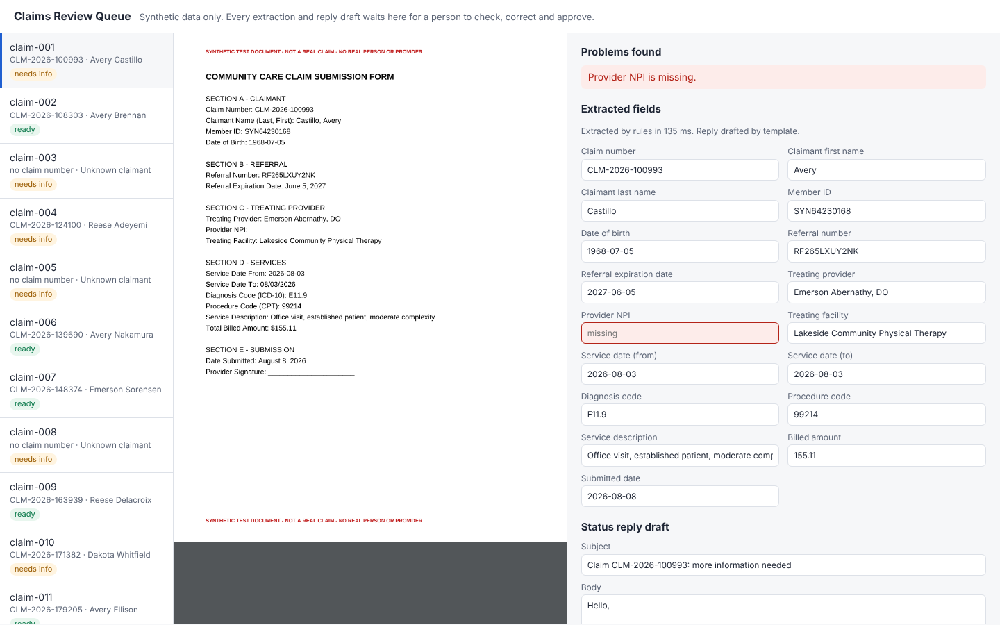

# Claims Document Assistant

An AI assistant for a claims-processing team. It reads claim PDFs, pulls out the fields an examiner needs, flags missing or invalid information, and drafts the status reply to the billing office. A person reviews, corrects and approves every result before anything goes out.

It runs entirely on **synthetic data**: every document is generated by this repo and stamped "SYNTHETIC TEST DOCUMENT - NOT A REAL CLAIM". No real person, provider or claim is involved.



## What it does

1. **Reads the document.** The PDF goes to Claude (`claude-opus-5-5`) as a document block. Structured outputs constrain the answer to a fixed claim schema, so the result is validated JSON, and the prompt tells the model to return `null` rather than guess.
2. **Checks it with rules, not the model.** Deterministic validation decides what is missing or wrong: required fields, NPI check digits, ICD-10 and CPT formats, date order, expired referrals, non-positive amounts. The model never decides on its own whether a claim is complete.
3. **Drafts the reply.** Claude writes a short status email from the rule findings ("received and complete" or "we need the following"). The status itself comes from the rules. A deterministic template takes over when no API key is set or the model call fails.
4. **Waits for a person.** Everything lands in a local review queue with the PDF beside the fields. The examiner edits fields or the draft, then approves, escalates or rejects. Corrections are re-validated, every decision is appended to an audit log with the reviewer's name and the fields they changed, and only approved replies are written to an outbox. The assistant never sends anything itself.

Refusals are handled explicitly: requests opt into the API's server-side refusal fallback, and if a request is still declined the document is routed to manual review instead of producing an empty result.

## Quick start

Requires Node.js 22+ (CI uses 24) and pnpm.

```bash
pnpm install
pnpm generate                      # 60 labelled synthetic claim PDFs in data/synthetic (already committed)
pnpm process data/synthetic        # extract, validate and draft; results queued in out/
pnpm review                        # review queue at http://127.0.0.1:4173/
```

Without an API key the commands use the offline **rules** extractor and template drafts. To use Claude, put `ANTHROPIC_API_KEY=...` in a `.env` file (see `.env.example`) or your environment; `process` and `eval` then default to the Claude extractor. Pass `--extractor rules` or `--extractor claude` to choose explicitly.

## Synthetic data

`src/generate.ts` produces seeded, reproducible claims with their ground truth. Field names follow the referral records from my earlier test-data generator ([Data Generator & File Processing](https://github.com/mohamedmoheyeldin/data-generator-file-processing)): referral number, treating provider and NPI, diagnosis code, service requested, treating facility.

Each document is one of three layouts, and the same value is written in different formats (`03/04/2026`, `2026-03-04`, `March 4, 2026`; `$1,234.50`, `1234.50 USD`):

| Layout | What it looks like |
|---|---|
| form | Labelled claim submission form |
| letter | Cover letter from a billing office, values inside sentences |
| note | Terse encounter note in shorthand (`Pt:`, `Mbr#`, `DOS`, `Dx`, `--` for blanks) |

About half are complete. The rest have one or two required fields left blank, or one invalid value (bad NPI check digit, expired referral, submitted before the date of service, malformed diagnosis code).

## Measured results

`pnpm eval` scores an extractor against the ground truth and writes `eval/<extractor>.md` and `.json`. Every number comes from that comparison; nothing is estimated.

**Rules extractor** (offline baseline, 60 documents, [eval/rules.md](eval/rules.md)):

| Layout | Documents | Field accuracy | Problems flagged correctly (precision / recall) |
|---|---|---|---|
| form | 31 | 100.0% | 100.0% / 100.0% |
| letter | 17 | 100.0% | 100.0% / 100.0% |
| note | 12 | 2.5% | 3.2% / 71.4% |
| **all** | **60** | **80.5%** | **17.9% / 94.3%** |

Mean processing time is under 10 ms per document. The baseline is perfect on the two templates its regular expressions were written for and fails on the shorthand note it has never seen: it returns nulls, so every field is flagged as missing. That gap is the reason for the model-based extractor, which reads all three layouts with one prompt and no template-specific rules.

**Claude extractor:** run `pnpm eval --extractor claude` with an API key to produce `eval/claude.md` (field accuracy by layout, flag precision and recall, time per document and token usage). Results are not committed yet.

## Tests

```bash
pnpm verify      # typecheck + test suite
```

The suite runs without an API key. It covers the validation rules (including NPI check digits against the generator), the generator's determinism and labels, the rules extractor on both known templates, the exact request the Claude extractor sends (document block, schema, fallback, no-guessing instruction) and its refusal handling using a stubbed client, the reply drafts, and the review API end to end: reviewer name required, corrections re-validated and logged, approved reply written to the outbox, and a second decision on the same claim refused.

## Layout

| Path | Purpose |
|---|---|
| `src/schema.ts` | Claim fields, required fields, issue types |
| `src/generate.ts` | Synthetic PDF and ground-truth generator |
| `src/extract/claude.ts` | Claude extractor (PDF document block + structured outputs) |
| `src/extract/rules.ts` | Offline rules baseline |
| `src/validate.ts` | Deterministic business rules |
| `src/draft.ts` | Claude and template status replies |
| `src/pipeline.ts` | Extract, validate, draft, queue for review |
| `src/evaluate.ts` | Scoring against ground truth |
| `src/review/` | Review queue server, page and audit log |

## Using it with real documents

This is a demonstration on synthetic data. Running it on real claims would also need: an agreement with the model provider that covers protected health information, authentication and access control on the review queue (it binds to `127.0.0.1` and has none), retention rules for the audit log and outbox, and an evaluation on a labelled sample of the real document mix before trusting any accuracy number.

## License

MIT
